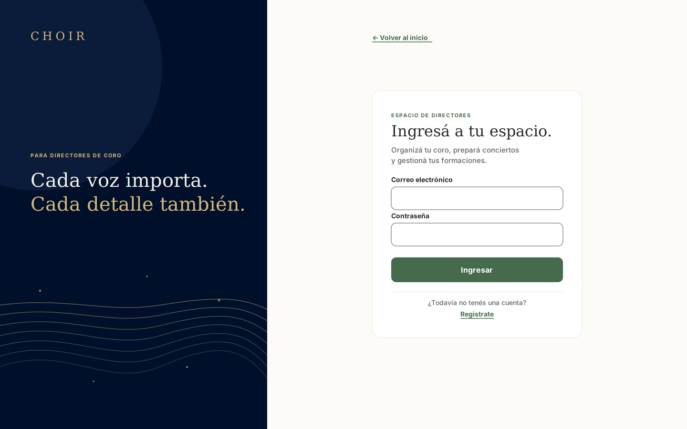
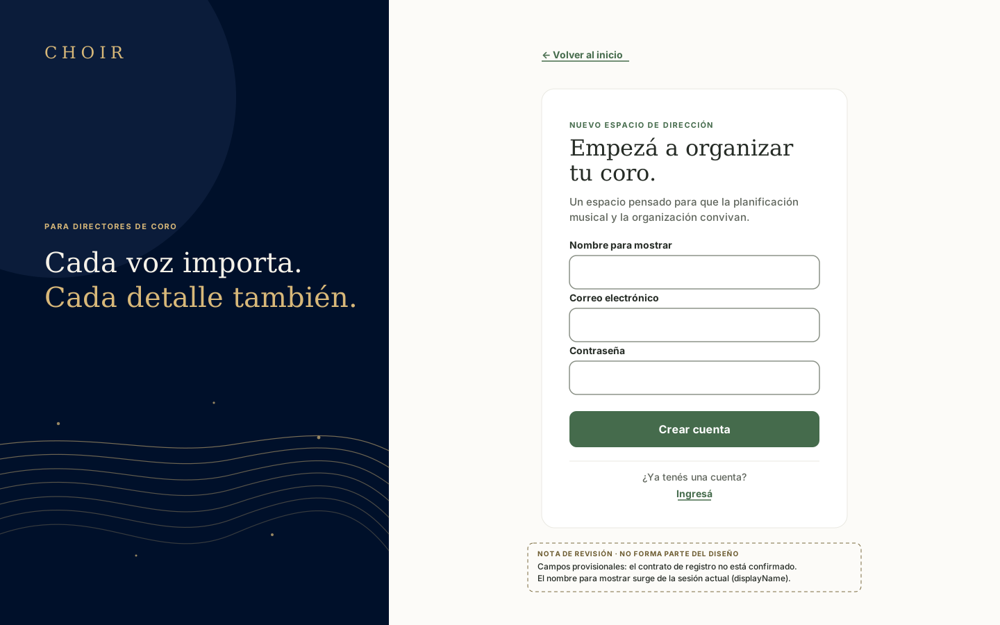
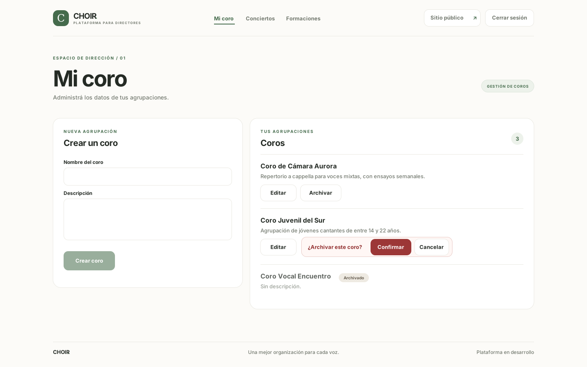
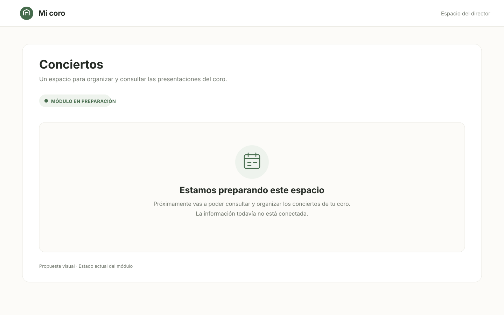
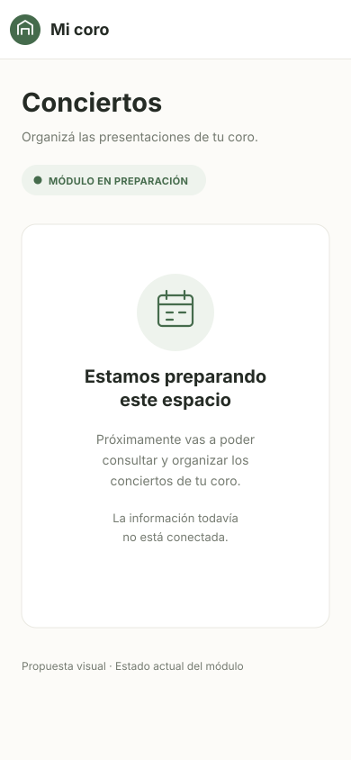

# CHOIR — Propuestas visuales

Estado: propuestas conceptuales de CHOIR-124. Pendientes de validación.

Este documento registra las propuestas visuales de escritorio y móvil.
No representa una implementación ni autoriza cambios en Angular o CSS.

## 1. Inicio

### Objetivo

Presentar CHOIR como una herramienta de dirección coral y facilitar el
acceso a las tres áreas principales disponibles desde la página inicial.

### Escritorio

- Navegación superior con marca y accesos a Inicio, Mi coro, Conciertos,
  Formaciones e Ingresar.
- Hero de identidad artística con fondo azul profundo.
- Mensaje principal: "Cada voz importa. Cada detalle también."
- Descripción breve del propósito de la plataforma.
- Acción principal: Comenzar.
- Acción secundaria: Explorar la plataforma.
- Ilustración musical abstracta como recurso decorativo.
- Sección operativa clara con tres accesos: Tu coro, Conciertos y Formaciones.
- Pie institucional discreto.

### Móvil

- Marca y navegación compacta.
- Hero en una columna.
- Mensaje principal con jerarquía tipográfica clara.
- Acciones de ancho suficiente para interacción táctil.
- Ilustración adaptada al ancho disponible.
- Accesos a las tres áreas apilados verticalmente.
- Sin desplazamiento horizontal.

### Dirección visual

- Ambiente artístico: azul profundo y dorado.
- Superficies operativas: marfil y blanco.
- Títulos artísticos con serif; textos de interfaz con sans-serif.
- Dorado reservado para acentos y acciones destacadas.
- Mantener el verde operativo actual como referencia para enlaces y acciones
  de gestión, sujeto a validación de contraste.

### Correspondencia con la implementación actual

La página existente presenta:
- Mensaje institucional y descripción.
- Acceso a Registro y a la plataforma.
- Accesos a Mi coro, Conciertos y Formaciones.
- Ilustración abstracta con referencias a las voces.

La propuesta reorganiza visualmente esos elementos. No implica agregar
redes sociales, nuevas rutas, autenticación ni funcionalidades adicionales.
Los elementos de navegación y pie institucional deberán contrastarse
con las rutas y capacidades reales antes de aprobar el diseño.

### Criterios de validación

- [ ] Confirmar navegación y destinos de cada enlace.
- [ ] Validar legibilidad y contraste en ambos tamaños.
- [ ] Revisar el comportamiento del menú móvil.
- [ ] Verificar que la ilustración sea decorativa para tecnologías
      de asistencia.
- [ ] Comprobar que las acciones principales sean visibles sin
      desplazamiento excesivo.
- [ ] Contrastar la propuesta con la implementación real.

## 2. Ingresar y Registro

Estado: propuesta conceptual pendiente de validación. No representa pantallas
implementadas ni autoriza cambios en Angular, CSS ni backend.

Recursos visuales (fuente SVG y vista previa PNG en `docs/assets/choir-124/`):

| Propuesta | Archivo |
|---|---|
| Ingresar — escritorio | `auth-login-desktop` |
| Ingresar — móvil | `auth-login-mobile` |
| Registro — escritorio | `auth-register-desktop` |
| Registro — móvil | `auth-register-mobile` |
| Registro, éxito — escritorio | `auth-register-success-desktop` |
| Registro, éxito — móvil | `auth-register-success-mobile` |
| Estados visuales | `auth-states` |

### Correspondencia con la implementación actual

- `/ingresar` carga `src/app/auth/login.page.ts`, que contiene un formulario
  funcional con correo, contraseña, estado de carga y mensajes de error.
  El `LoginPage` placeholder de `src/app/pages.ts` corresponde a una implementación anterior y no es la pantalla
  enrutada. La propuesta de Ingresar es una reorganización visual del
  formulario existente y debe conservar sus campos, acciones y
  comportamiento.
- `/registro` carga `RegisterPage` de `src/app/auth/register.page.ts`, que implementa
  un formulario funcional. El backend dispone de un endpoint de
  registro, pero su disponibilidad depende de configuración y de que exista
  un mecanismo de envío de correo de verificación.
- Los mensajes de error de Ingresar reutilizan el texto existente, que ya
  menciona que el correo debe estar verificado.

### Decisiones de diseño

- **Dos ambientes, sin oscurecer todo.** Escritorio: panel artístico
  (azul `#00102A`, dorado `#D8B879`, títulos en serif con el mensaje de
  Inicio) junto a una tarjeta operativa clara (`#FCFBF8`/`#FFFFFF`, Inter).
  El formulario nunca se apoya sobre fondo oscuro.
- **Verde operativo conservado** para la acción principal y los enlaces
  (`#456B4C` sobre blanco: 6.07:1, calculado).
- **Marca y recurso gráfico moderado:** ondas doradas finas y puntos
  decorativos (`aria-hidden`) solo en el panel o la banda superior.
- **Misma estructura en ambas pantallas:** eyebrow, título serif, bajada,
  campos con etiqueta siempre visible, acción principal de ancho completo y
  enlace al flujo opuesto subrayado (no depende solo del color).
- Se mantiene el enlace "Volver al inicio" que ya existe en Ingresar.
- No se incorpora recuperación de contraseña, mostrar/ocultar contraseña,
  autenticación social ni "recordarme".

### Contrato de Registro verificado en backend

La revisión del código backend en `main` confirmó lo siguiente:

- Endpoint: `POST /api/auth/register`.
- Request: `displayName`, `email` y `password`.
- `displayName`: obligatorio, máximo 160 caracteres.
- `email`: obligatorio, formato válido, máximo 254 caracteres.
- `password`: obligatoria, entre 12 y 200 caracteres.
- No se confirmó una regla adicional de composición de contraseña.
- El registro requiere que `choir.auth.registration.enabled` esté habilitado,
  que exista un `VerificationEmailSender` disponible y que
  `choir.auth.verification-url-base` tenga un valor no vacío.
- Si alguna de esas condiciones no se cumple, el backend responde HTTP 503
  con `registration_unavailable`.
- Si el registro se procesa, responde HTTP 202 Accepted con un mensaje
  genérico que indica que, si el registro está disponible, se enviará un
  correo de verificación.
- Si el correo ya existe, el backend devuelve la misma respuesta HTTP 202
  genérica. El diseño no debe intentar distinguir ese caso ni revelar si
  una dirección está registrada.
- El alta crea una cuenta sin verificar. No inicia sesión automáticamente.
- El token de verificación vence a los 30 minutos y es de un solo uso.
- La verificación se realiza mediante `POST /api/auth/verify-email`,
  enviando el campo `token`.
- Un token válido produce HTTP 200; uno inválido o vencido produce HTTP 400
  con `invalid_or_expired_token`.
- No se encontró un endpoint de reenvío de correo de verificación.
- El login no distingue públicamente entre credenciales incorrectas y
  correo no verificado: ambos casos se responden como `invalid_credentials`.

La configuración incluida en `application.yml` tiene el registro deshabilitado
por defecto y la URL de verificación vacía. Esto no permite concluir cuál es
la configuración efectiva de un entorno desplegado, ya que puede sobrescribirse
mediante configuración externa.

### Seguridad y protección CSRF

El registro utiliza la protección CSRF existente:

1. Obtener el token mediante `GET /api/auth/csrf`.
2. Conservar la cookie de sesión recibida.
3. Enviar el token en el header `X-CSRF-TOKEN` al realizar el POST.

La autorización pública de la ruta no elimina la protección CSRF. La futura
implementación visual deberá respetar el mecanismo utilizado por el cliente
de autenticación existente y no asumir que el POST puede ejecutarse sin
cookie ni token.

### Comportamiento visual propuesto para Registro

- Los campos de la propuesta corresponden a `displayName`, `email` y
  `password`.
- No se agrega confirmación de contraseña: no forma parte del request
  confirmado.
- La validación del frontend debe respetar los límites confirmados y no
  inventar reglas de composición.
- La respuesta HTTP 202 debe mostrar un mensaje neutral que indique que,
  si el registro está disponible, se enviará un correo de verificación.
- No debe mostrarse un mensaje que asegure que la cuenta fue creada o que
  el correo fue enviado en todos los casos.
- El estado visual de éxito puede explicar que se debe revisar el correo
  para continuar, sin revelar si la dirección ya existía.
- No debe ofrecerse una acción de reenvío: no se encontró esa operación
  en el backend revisado.
- La respuesta HTTP 503 debe comunicarse como indisponibilidad temporal
  del registro, sin atribuirla a los datos ingresados.
- La verificación de correo es un paso separado. La URL de destino del
  enlace de verificación y su pantalla frontend deben confirmarse antes
  de diseñarlas como un flujo implementable.

### Escritorio y móvil

| Aspecto | Escritorio | Móvil |
|---|---|---|
| Composición | Dos zonas: panel artístico (≈40 %) y zona operativa | Una columna; banda azul compacta (120 px) con marca |
| Formulario | Tarjeta de 440 px (campos de 360 px), centrada | Ancho completo con margen de 24 px |
| Título | Serif 32 px | Serif 28 px |
| Controles | Campos de 48 px, botón de 52 px | Igual altura; botón y campos de ancho completo |
| Enlace a la otra pantalla | Línea de texto bajo un separador | Dos líneas; área de toque ≥ 44 px |
| Desplazamiento | Sin desplazamiento en 1440×900 | Solo vertical; sin desplazamiento horizontal |

La acción principal queda dentro del flujo del formulario, no fija al borde
inferior, para no quedar tapada por el teclado del móvil.

### Estados visuales

Ver `auth-states`. Se definen para Ingresar y Registro:

- **Reposo:** borde de campo reforzado y etiqueta visible.
- **Foco:** borde de 2 px en verde más halo; el botón usa anillo oscuro.
- **Error:** borde, ícono y texto asociados al campo (`aria-invalid` y
  `aria-describedby`); el error de la operación usa `role="alert"`.
- **Carga:** campos bloqueados y botón con indicador; el texto debe
  corresponder a la operación en curso y no sugerir que se inició sesión
  durante el registro.
- **Deshabilitado:** relleno neutro y texto atenuado, distinguible sin color.

El estado de éxito de Registro se propone en `auth-register-success-*`:
aviso neutral sobre el siguiente paso de verificación y acceso a Ingresar.
El mensaje no debe afirmar que el correo fue enviado efectivamente en todos
los casos, porque el backend utiliza una respuesta genérica.

Los textos de validación y el copy visual son propuestas. No deben
presentarse como mensajes exactos del backend salvo los códigos y respuestas
confirmados en esta sección.

### Estado de contraste y tokens (auditoría pendiente)

Los valores de contraste de análisis anteriores no deben interpretarse como
validación de los tokens actuales:
- `--choir-muted` tiene actualmente el valor `#6B7168`. El cálculo histórico
  de `#747A70` y el candidato `#5F655C` no representan una decisión vigente.
  El contraste del token actual debe medirse nuevamente.
- `--choir-line` tiene el valor `#E9E8E1` y se reserva para separadores
  decorativos. No debe utilizarse como borde universal de campos o controles.
- `#8A9086` continúa siendo un candidato para bordes de controles, no un
  token aprobado ni una decisión implementada.
- El foco vigente utiliza `--focus-ring: 3px solid var(--choir-accent-dark)`
  con un desplazamiento de 3 px. La cobertura está definida en los estilos
  globales; su contraste y comportamiento requieren validación manual.

La auditoría de contraste y accesibilidad continúa pendiente en CHOIR-140.
No declarar conformidad WCAG 2.2 AA hasta completar las mediciones y pruebas.

### Recomendaciones para incorporar al flujo de revisión

- Mantener esta sección y registrar aquí las decisiones aceptadas o
  descartadas tras la revisión.
- Mantener diferenciados los formularios funcionales de Ingresar y Registro, y sus
  respectivos estados de implementación.
- Contrastar la propuesta de Registro con el contrato backend documentado
  en esta sección antes de implementar.
- Confirmar la ruta frontend de verificación y la configuración efectiva
  de los entornos antes de cerrar el diseño del recorrido completo.
- Reconciliar DS-02 en `design-backlog.md` con el contrato verificado.
- DS-02 Etapa A y DS-02 Etapa B deben gestionarse como tickets Jira independientes, cada uno con su propia rama y PR. La Etapa A cubre el diseño visual; la Etapa B cubre exclusivamente la integración funcional de Registro y permanece bloqueada hasta resolver sus dependencias.

### Criterios de validación

- [ ] Confirmar la configuración efectiva de Registro en los entornos
      donde se habilitará.
- [ ] Validar el envío CSRF desde el cliente frontend.
- [ ] Confirmar la ruta frontend de destino del enlace de verificación.
- [ ] Medir contrastes con herramienta sobre los tokens definitivos.
- [ ] Probar navegación por teclado y foco en ambos formularios.
- [ ] Probar en móvil real con teclado abierto y zoom al 200 %.
- [ ] Verificar mensajes de error con lector de pantalla.
- [ ] Contrastar la propuesta final con la implementación real.

## 3. Otras pantallas

Pendientes de propuesta visual:
- Mi coro y gestión de coreutas.
- Conciertos.
- Formaciones y transiciones.

Cada pantalla deberá documentarse para escritorio y móvil, respetando
los datos, permisos, rutas y operaciones existentes.

## 4. Mi coro, Conciertos y Formaciones

Estado: auditoría estática de las pantallas y componentes existentes en
`main`. Las propuestas siguientes son conceptuales y requieren validación
visual y manual. No autorizan cambios funcionales ni de estilos.

### 4.1 Mi coro

#### Funcionalidad observada

La pantalla permite:
- Consultar los coros disponibles.
- Crear un coro mediante nombre y descripción.
- Editar los datos de un coro.
- Archivar un coro mediante confirmación.
- Distinguir visualmente los coros archivados.
- Reconocer estados de carga, error y ausencia de resultados.

La pantalla no implementa en este flujo un listado de coreutas, búsqueda,
filtros ni una vista de detalle del coro. Esas capacidades no deben
incorporarse a la propuesta como si ya existieran.

#### Problemas y oportunidades

- El formulario y el listado compiten por la atención visual.
- Las filas del listado reúnen nombre, descripción y acciones sin una
  jerarquía suficientemente marcada.
- La condición de archivado necesita distinguirse sin depender únicamente
  del color.
- La confirmación de archivado debe mantener una relación visual clara
  con el coro sobre el que se está actuando.
- En pantallas pequeñas, las acciones de cada fila necesitan conservar
  espacio y objetivos táctiles adecuados.
- Los estados de carga, error y lista vacía deben tener una presentación
  consistente y no confundirse entre sí.

#### Propuesta de escritorio

- Encabezado de página con título, descripción breve y contexto del coro.
- Formulario de alta en una tarjeta diferenciada, con jerarquía secundaria
  respecto del listado cuando ya existen coros.
- Listado como área principal de trabajo.
- Cada coro se presenta como una unidad visual con nombre destacado,
  descripción secundaria y acciones agrupadas.
- Estado archivado mediante texto o indicador explícito además de su
  tratamiento visual.
- Confirmación de archivado asociada a la fila correspondiente, con
  acciones de confirmar y cancelar claramente diferenciadas.

#### Propuesta móvil

- Encabezado compacto y contenido en una sola columna.
- Formulario accesible sin competir horizontalmente con el listado.
- Cada coro se presenta como tarjeta o bloque apilado.
- Acciones agrupadas debajo de los datos, sin depender de hover.
- Confirmación dentro del contexto del elemento afectado.
- Sin desplazamiento horizontal ni controles demasiado próximos.

#### Límites de la propuesta

No agregar búsqueda, filtros, detalle, gestión de integrantes ni nuevas
operaciones. La propuesta reorganiza la presentación de las capacidades
existentes.

#### Referencias visuales

Mockups conceptuales de alta fidelidad, pendientes de validación. No
representan una implementación. Los nombres de coros son datos de ejemplo
solo para el mockup; los textos y estados provienen de la pantalla actual.

| Referencia | Archivo (`docs/assets/choir-124/`) |
|---|---|
| Escritorio, 1440 × 900 | `mi-coro-desktop` (y `@2x`) |
| Móvil, 390 × 844 | `mi-coro-mobile` (y `@2x`) |
| Estados | `mi-coro-estados` |

Decisiones y salvedades:

- La referencia visual usa `#E9E8E1` en bordes de campo; no debe tomarse
  como decisión de implementación. La auditoría de controles sigue pendiente.
- Se subraya el ítem activo de la navegación y los banners de error
  incluyen ícono, para no depender solo del color.
- Los botones del listado miden 40 px en escritorio y 44 px en móvil.
- Los bordes de campo usan `#E9E8E1`, con la observación de contraste
  abierta en la sección 2 de este documento.

### 4.2 Conciertos

#### Funcionalidad observada

La ruta actual muestra:
- Título y descripción del módulo.
- Indicador de módulo en preparación.
- Panel informativo sobre la futura presentación.
- Mensaje que aclara que los datos todavía no están conectados.

No existe en esta pantalla un listado funcional de conciertos, filtros,
calendario, detalle ni acciones de creación o edición.

#### Problemas y oportunidades

- El estado de módulo en preparación debe ser inequívoco.
- No debe confundirse la falta de integración del módulo con un listado
  vacío de conciertos reales.
- La presentación debe explicar el alcance disponible sin simular
  operaciones que todavía no existen.
- La pantalla necesita conservar la identidad visual operativa de CHOIR,
  sin aparentar que la gestión está habilitada.

#### Propuesta de escritorio

- Encabezado con título y descripción breve.
- Estado visible de módulo en preparación, expresado mediante texto
  además de cualquier indicador cromático.
- Panel central de información con una explicación concisa del estado
  actual.
- Composición sobria, con superficie clara y jerarquía tipográfica.
- No mostrar tarjetas de conciertos ficticios ni acciones inactivas
  que sugieran funcionalidades disponibles.

#### Propuesta móvil

- Encabezado compacto.
- Indicador de preparación próximo al título.
- Panel informativo de ancho completo y lectura sencilla.
- Texto breve, con espaciado suficiente y sin elementos decorativos
  que compitan con el mensaje.
- Sin desplazamiento horizontal.

#### Límites de la propuesta

Esta pantalla debe seguir representando un módulo en preparación.
No diseñar como funcionalidades existentes un calendario, listado,
filtros, creación, edición, detalle ni estados de conciertos.

La futura gestión de conciertos requiere validar primero los flujos,
contratos, permisos y operaciones funcionales correspondientes.

### 4.3 Formaciones

#### Funcionalidad observada

El flujo existente permite:
- Seleccionar un coro.
- Seleccionar un concierto.
- Seleccionar una obra del repertorio.
- Seleccionar una formación o crearla con nombre y descripción.
- Consultar el borrador y las posiciones asociadas a la formación.
- Visualizar al director y a los integrantes posicionados en el escenario.
- Arrastrar integrantes para modificar su posición.
- Bloquear y desbloquear posiciones.
- Quitar integrantes de la formación.
- Guardar las posiciones.
- Reconocer estados de carga, error, reintento y confirmación de guardado.

El escenario muestra estados diferenciados para carga, error, ausencia de
borrador y formación sin integrantes. Los controles de integrantes incluyen
acciones para quitar y bloquear posiciones.

#### Problemas y oportunidades

- La selección de coro, concierto, repertorio y formación puede competir
  visualmente con el escenario, aunque representa una secuencia de contexto.
- El escenario debe ser el área visual principal una vez seleccionado
  el contexto necesario.
- El elenco disponible y las acciones de incorporación necesitan una
  jerarquía secundaria, pero deben seguir siendo fáciles de localizar.
- Los nombres y las secciones vocales deben permanecer legibles en el
  escenario.
- Los estados de bloqueo, selección y movimiento necesitan señales
  comprensibles que no dependan solo del color.
- Las acciones de quitar y bloquear deben conservar una asociación
  inequívoca con cada integrante.
- La interfaz debe distinguir cambios todavía no guardados de posiciones
  persistidas.
- En móvil, el escenario requiere una reorganización específica: reducir
  el ancho de las tarjetas puede afectar la lectura de nombres y secciones.
- El movimiento actual se basa en eventos de puntero. No se identificó
  en el template una alternativa equivalente de teclado para cambiar
  posiciones; debe tratarse como una necesidad de accesibilidad pendiente.

#### Propuesta de escritorio

- Presentar los selectores como una secuencia de contexto, agrupados y
  ordenados: coro, concierto, obra y formación.
- Mantener visible el contexto seleccionado para evitar dudas sobre
  qué concierto y obra se están editando.
- Una vez disponible el borrador, dar prioridad visual al escenario.
- Conservar una referencia visible de la dirección del coro y la
  orientación del escenario.
- Mostrar nombre y sección vocal de cada integrante con jerarquía
  tipográfica suficiente.
- Mantener las acciones de bloqueo y quitar vinculadas visualmente
  a cada integrante.
- Ubicar el elenco disponible en un panel secundario, con controles
  distinguibles para agregar o quitar integrantes según el flujo actual.
- Agrupar las acciones de guardado y sus mensajes de resultado en una
  zona estable y fácil de localizar.
- Diferenciar carga del contexto, carga del borrador y guardado.

#### Propuesta móvil

- Organizar los selectores en una secuencia vertical, con etiquetas
  visibles y contexto seleccionado reconocible.
- Evitar que todos los controles y el escenario compitan en el primer
  nivel visual.
- Dar al escenario el ancho disponible y preservar la relación espacial
  entre integrantes.
- Mantener nombres y secciones legibles; no reducirlos hasta volverlos
  ambiguos.
- Reubicar las acciones de cada integrante para que no queden fuera
  del área visible ni se superpongan con otros controles.
- Presentar el elenco disponible en un bloque separado del escenario,
  conservando acceso a las operaciones existentes.
- Mantener el guardado y sus mensajes accesibles sin exigir precisión
  excesiva de desplazamiento o interacción.

#### Accesibilidad y validaciones pendientes

- Definir una alternativa operable por teclado para modificar posiciones,
  sin asumir que el arrastre por puntero es suficiente.
- Verificar nombres accesibles y orden de navegación de los integrantes.
- Revisar cómo se anuncian selección, bloqueo, carga y cambios de posición.
- Comprobar que los botones contextuales sean localizables y operables
  con teclado y tecnologías de asistencia.
- Validar el escenario con zoom y anchos móviles reales.
- Revisar movimiento reducido y evitar que una animación sea el único
  medio para comunicar un cambio.
- No declarar conformidad WCAG sin completar las pruebas manuales.

#### Límites de la propuesta

No modificar algoritmos de distribución, reglas de negocio, contratos,
persistencia ni operaciones del flujo. No agregar nuevas métricas ni
nuevos modos de edición.

La alternativa accesible al arrastre debe definirse en un ticket específico
y validarse contra el comportamiento funcional existente antes de
implementarse.

### 4.4 Criterios comunes de validación

- [ ] Contrastar cada propuesta con la pantalla real y sus estados.
- [ ] Validar escritorio, tablet y móvil con anchos representativos.
- [ ] Verificar que ninguna propuesta agregue operaciones inexistentes.
- [ ] Comprobar contraste de texto, controles, bordes y foco.
- [ ] Revisar navegación por teclado y nombres accesibles.
- [ ] Validar mensajes de carga, error, vacío, confirmación y éxito
      cuando esos estados existan en el flujo.
- [ ] Registrar evidencia de las pruebas manuales.
- [ ] Revisar dependencias funcionales en Jira antes de convertir
      propuestas en tickets de implementación.

Estas propuestas complementan la auditoría inicial. No representan
diseños aprobados ni una certificación de accesibilidad.

## 5. Validación de propuestas existentes — CHOIR-141

Estado: revisión estática de rutas, templates y estilos de `develop`.
No implica implementación visual ni cambios funcionales.

### 5.1 Inicio

**Correspondencia verificada**

- La página contiene el mensaje institucional, descripción, acciones Comenzar y Explorar la plataforma.
- Presenta accesos a Mi coro, Conciertos y Formaciones.
- La ilustración `.hero-art` es decorativa y está marcada `aria-hidden="true"`.
- El encabezado y el pie institucional pertenecen al shell general de la aplicación.

**Decisiones**

- Aceptar la estructura de hero y los tres accesos como base de la propuesta.
- Aceptar la ilustración como recurso decorativo.
- Descartar que el menú público incluya accesos directos a Mi coro, Conciertos y Formaciones: esos módulos pertenecen al espacio autenticado.
- Mantener diferenciados los accesos públicos y los enlaces del espacio de trabajo.

**Responsive observado**

- Hero en dos columnas en escritorio y una columna hasta 850 px.
- Tarjetas en tres columnas, dos columnas en tamaños intermedios y una columna hasta 560 px.
- La navegación del espacio de trabajo permite desplazamiento horizontal cuando necesita acomodar sus enlaces.

### 5.2 Ingresar

**Correspondencia verificada**

- La ruta `/ingresar` carga `src/app/auth/login.page.ts`.
- El formulario funcional contiene correo electrónico y contraseña.
- Incluye estado de carga, errores anunciados mediante `role="alert"`, acción para ingresar y enlace a Registro.
- Incluye navegación para volver al inicio.
- El acceso exitoso conduce a `/app/coro`.

**Diferencias respecto de la propuesta**

- La implementación actual utiliza una composición operativa de una columna.
- No existe el panel artístico lateral propuesto para escritorio.
- La propuesta de dos ambientes visuales representa una reorganización futura, no el estado actual.

**Decisiones**

- Aceptar los campos, acciones y comportamiento existentes como restricciones obligatorias.
- Mantener el enlace a Registro y el retorno al inicio.
- Conservar la propuesta dividida como alternativa de rediseño, identificándola expresamente como futura.
- No incorporar recuperación de contraseña, autenticación social ni otras operaciones no implementadas.

### 5.3 Registro

**Corrección de documentación**

La descripción anterior que identificaba `/registro` como placeholder está desactualizada.

La ruta carga `src/app/auth/register.page.ts`, con estilos en `src/app/auth/register.page.scss`.

**Correspondencia verificada**

- Composición dividida entre panel artístico y contenido operativo.
- Campos funcionales: nombre para mostrar, correo electrónico y contraseña.
- Validaciones de longitud y formato.
- Estado de envío y botón deshabilitado durante la operación.
- Mensajes de error anunciados mediante `role="alert"`.
- Confirmación mediante `role="status"`.
- Enlace a Ingresar.
- En móvil, el panel artístico se convierte en una banda compacta y el contenido pasa a una columna.

**Decisiones**

- Aceptar la composición general de dos ambientes visuales.
- Aceptar la estructura de tres campos y sus restricciones verificadas.
- Aceptar el estado de confirmación como estado de la misma pantalla, no como una ruta independiente.
- Mantener el mensaje neutral de confirmación y la posibilidad de indisponibilidad del registro.
- No agregar reenvío de correo ni acciones que el backend no ofrece.
- No considerar la propuesta de Ingresar y Registro como dos implementaciones visuales idénticas: sus composiciones actuales son diferentes.

### 5.4 Mi coro

**Correspondencia verificada**

- La pantalla permite consultar coros, crear, editar y archivar.
- La interfaz separa el formulario de gestión y el listado.
- Los registros muestran nombre, descripción y acciones disponibles.
- Los coros archivados tienen una etiqueta explícita.
- La confirmación de archivado se presenta en el contexto del registro.
- Existen estados de carga, error, reintento, éxito y lista vacía.
- En tamaños reducidos, el formulario y el listado pasan a una columna.
- Las acciones pueden distribuirse en varias líneas.

**Diferencias respecto de la propuesta**

- La implementación utiliza filas separadas por bordes, no tarjetas independientes para cada coro.
- El formulario ocupa la primera columna y el listado la segunda; el listado tiene mayor proporción.
- La propuesta móvil de tarjetas puede conservarse como alternativa, pero no debe documentarse como comportamiento ya implementado.

**Decisiones**

- Aceptar la jerarquía general entre formulario y listado.
- Aceptar la identificación textual de coros archivados.
- Aceptar la confirmación contextual y los estados existentes.
- Mantener como fuera de alcance la gestión de coreutas, búsqueda, filtros y detalle de coro: no están implementados en esta pantalla.
- Registrar las tarjetas móviles como una opción de diseño futuro, no como una característica actual.

### 5.5 Alcance de esta validación

La revisión combina el contraste estático de rutas, templates, lógica y estilos de `develop` con la inspección visual de las capturas reales compartidas para las cuatro pantallas: Inicio, Ingresar, Registro y Mi coro.

La validación visual se realizó en Chrome para Android con la opción «Sitio para computadoras» desactivada. Se registran las diferencias entre la propuesta y la interfaz observada, sin presentar elementos conceptuales como funcionalidades existentes.

Esta revisión no constituye una certificación de accesibilidad ni una prueba exhaustiva de todos los tamaños, navegadores y estados posibles.

No se realizaron cambios de Angular, CSS, contratos API ni reglas de negocio.

### 5.6 Aclaración del comportamiento móvil — Inicio

La observación inicial de espacio vacío debajo del contenido se produjo con Chrome para Android en modo «Sitio para computadoras». Al desactivar esa opción, la vista responsive de `main` se presenta correctamente y el problema no se reproduce como defecto de distribución vertical de la aplicación.

Por lo tanto:

- No se registra un defecto responsive pendiente en Inicio.
- No se requieren cambios de CSS por esta observación.
- La aplicación mantiene el comportamiento responsive basado en el viewport; no debe forzar un modo móvil o escritorio por detección del dispositivo.
- La preferencia «Sitio para computadoras» pertenece al navegador y no puede ser anulada por la aplicación web.

La observación inicial queda cerrada como incidencia de configuración del navegador, no como defecto de CHOIR.

## CHOIR-142 — Propuesta visual de Conciertos

Esta propuesta documenta la presentación del módulo actual en escritorio y móvil. Es una tarea independiente de CHOIR-124.

### Escritorio

### Móvil

### Criterios de diseño

- Mantener el encabezado y la identidad visual del espacio Mi coro.
- Comunicar de forma visible que el módulo está en preparación.
- Explicar que la información todavía no está conectada.
- No representar conciertos ficticios ni una lista vacía que pueda confundirse con una funcionalidad operativa.
- No incorporar filtros, calendario, creación, edición, detalle ni acciones que todavía no existen.
- En móvil, priorizar lectura vertical, panel de ancho disponible y ausencia de desplazamiento horizontal.
- Mantener colores, tipografía, bordes, espaciado y estados coherentes con `docs/design-system.md`.

Estas imágenes son propuestas estáticas de presentación del estado actual; no implican implementación funcional ni cambios de API.

## CHOIR-143 — Propuesta conceptual de Formaciones

Propuesta visual independiente de CHOIR-124 para las vistas de escritorio y móvil del editor de Formaciones.

### Material visual

- Escritorio: `docs/assets/choir-143/formations-desktop.svg`
- Móvil: `docs/assets/choir-143/formations-mobile.svg`

### Criterios de diseño

- Presentar el contexto de trabajo en una secuencia clara: coro, concierto, obra del repertorio y formación.
- Dar prioridad visual a la disposición de integrantes en el escenario.
- Mantener el listado de integrantes próximo al escenario en escritorio y debajo de este en móvil.
- En pantallas pequeñas, organizar el contenido en una única columna y priorizar la lectura vertical.
- Representar visualmente las capacidades existentes del editor: selección de contexto y formación, visualización y edición de posiciones, bloqueo de posiciones, incorporación y eliminación de integrantes y guardado de borradores.
- Mantener la paleta, tipografía, espaciado, contraste y criterios de accesibilidad definidos en el sistema de diseño.

### Alcance y límites

Las imágenes son propuestas conceptuales estáticas, no implementaciones funcionales. Los nombres, identificadores y posiciones que aparecen son datos ficticios de maqueta; no representan coros, conciertos, obras ni personas reales.

La propuesta toma como referencia las capacidades identificadas en el código existente. La validación operativa con datos reales y la comprobación de todos los estados del editor siguen pendientes. Por lo tanto, las imágenes no certifican esos comportamientos ni introducen reglas de negocio nuevas.

Este trabajo no modifica componentes Angular, estilos funcionales, servicios, API, persistencia ni algoritmos de formación. Tampoco depende de la finalización de CHOIR-124.

## CHOIR-144 — Propuesta conceptual de Transiciones

Propuesta visual independiente de CHOIR-124 para explorar la relación entre una formación de origen y una formación de destino.

### Material visual

- Escritorio: `docs/assets/choir-144/transitions-desktop.svg`
- Móvil: `docs/assets/choir-144/transitions-mobile.svg`

### Criterios de diseño

- Organizar la composición alrededor de dos referencias visuales diferenciadas: formación de origen y formación de destino.
- En escritorio, presentar ambas referencias en paralelo para facilitar su lectura comparativa.
- En móvil, disponerlas en una única columna y conectar visualmente el origen con el destino.
- Utilizar una dirección visual sobria: superficies operativas claras, acentos artísticos moderados y jerarquía tipográfica consistente.
- Mantener la relación entre ambos paneles como recurso conceptual, sin atribuirle reglas de negocio ni resultados.
- Identificar de forma visible el carácter futuro y no implementado de la propuesta.

### Alcance y límites

Las imágenes son propuestas conceptuales estáticas. No representan una pantalla, flujo ni funcionalidad frontend actualmente implementados. Los paneles son esquemáticos y permanecen vacíos deliberadamente: no contienen nombres, integrantes, posiciones, conciertos, obras, métricas ni transiciones simuladas.

La composición comunica únicamente el concepto de comparar una formación de origen con una de destino. No define cómo se seleccionan, evalúan, comparan, modifican o publican las transiciones, ni establece estados operativos, algoritmos o reglas de negocio.

Este trabajo no modifica componentes Angular, estilos funcionales, servicios, API, backend ni persistencia. Es independiente de CHOIR-124 y no condiciona su cierre.
