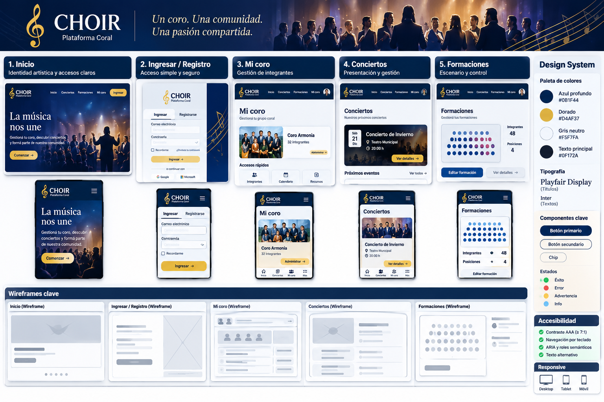

# CHOIR — Referencias visuales y wireframes

Estado: propuesta de diseño de CHOIR-124. Pendiente de validación.

Este documento complementa `design-discovery.md`, `design-system.md` y
`design-backlog.md`.

Los wireframes describen la estructura y la jerarquía de cada pantalla.
No constituyen una especificación funcional nueva ni autorizan cambios
en Angular o backend.

## 1. Dirección visual

### Identidad artística

Aplicar la identidad azul profundo y dorado en las experiencias de
presentación y comunicación artística:

- Inicio y presentación de la plataforma.
- Presentación de conciertos.
- Encabezados y destacados de contenido artístico.
- Mensajes y elementos visuales asociados a actuaciones.

### Experiencia operativa

Mantener una interfaz clara para las tareas frecuentes:

- Formularios y autenticación.
- Administración del coro.
- Gestión de conciertos.
- Edición de formaciones.
- Tablas, listados y paneles de control.

La propuesta no reemplaza automáticamente la paleta operativa existente.
La convivencia entre ambas identidades debe validarse antes de implementar.

## 2. Wireframe: Inicio

### Objetivo

Explicar qué ofrece CHOIR y facilitar el acceso a las acciones principales.

### Escritorio

1. Encabezado con logotipo y navegación principal.
2. Hero con mensaje institucional y fotografía o recurso artístico.
3. Acción principal para comenzar.
4. Accesos a las capacidades principales de la plataforma.
5. Sección secundaria de presentación y beneficios.
6. Pie de página institucional.

### Móvil

1. Logotipo y menú compacto.
2. Mensaje principal.
3. Imagen artística adaptada al ancho disponible.
4. Acción principal visible.
5. Accesos secundarios en tarjetas apiladas.
6. Navegación sin desplazamiento horizontal.

### Criterios

- La acción principal debe distinguirse claramente.
- El contenido debe conservar legibilidad sobre imágenes.
- La imagen no debe ser necesaria para comprender el mensaje.
- El encabezado debe adaptarse a pantallas pequeñas.

## 3. Wireframe: Ingresar y Registro

### Objetivo

Ofrecer una experiencia de acceso sencilla, consistente y accesible.

### Escritorio

1. Marca CHOIR.
2. Panel central de autenticación.
3. Selector o enlace entre Ingresar y Registro.
4. Campos del formulario.
5. Mensajes de validación junto al campo correspondiente.
6. Acción principal.
7. Enlaces secundarios y recuperación de acceso, si están disponibles.

### Móvil

1. Marca en la parte superior.
2. Formulario en una única columna.
3. Campos ocupando el ancho disponible.
4. Acción principal de ancho completo.
5. Enlaces secundarios claramente separados.

### Estados que deben diseñarse

- Inicial.
- Cargando.
- Validación de campos.
- Error de autenticación o registro.
- Operación exitosa.

No agregar proveedores de autenticación ni flujos de recuperación que
no estén contemplados en los contratos y funcionalidades existentes.

## 4. Wireframe: Mi coro

### Objetivo

Facilitar la consulta y administración cotidiana del coro.

### Escritorio

1. Encabezado con nombre del coro y contexto.
2. Resumen de integrantes y datos relevantes disponibles.
3. Acciones principales de administración.
4. Listado de integrantes.
5. Información secundaria y filtros cuando correspondan.

### Móvil

1. Encabezado compacto.
2. Resumen en tarjetas apiladas.
3. Acciones principales visibles.
4. Integrantes en filas o tarjetas.
5. Acciones individuales accesibles sin depender del hover.

### Criterios

- Diferenciar claramente información y acciones.
- Mantener consistencia entre estados vacíos y listados cargados.
- No ocultar acciones esenciales en pantallas pequeñas.
- Respetar permisos y capacidades existentes.

## 5. Wireframe: Conciertos

### Objetivo

Combinar la presentación artística de los conciertos con su gestión.

### Escritorio

1. Encabezado de la sección.
2. Acción para crear un concierto, si el usuario tiene permiso.
3. Próximos conciertos y conciertos anteriores.
4. Tarjetas con nombre, fecha, lugar y estado cuando esos datos existan.
5. Acceso al detalle y a las acciones disponibles.

### Móvil

1. Encabezado y acción principal.
2. Listado vertical de conciertos.
3. Fecha y estado identificables rápidamente.
4. Detalle accesible desde cada tarjeta.
5. Acciones secundarias agrupadas y fáciles de utilizar.

### Criterios

- Diferenciar próximos conciertos de los ya realizados.
- No depender exclusivamente del color para comunicar estados.
- Mantener visibles fechas y datos importantes.
- No inventar estados ni información que no entregue el backend.

## 6. Wireframe: Formaciones

### Objetivo

Facilitar la visualización y edición de las posiciones de los integrantes.

### Escritorio

1. Encabezado con contexto del concierto o formación.
2. Selector de contexto cuando corresponda.
3. Escenario como área visual principal.
4. Integrantes representados mediante elementos identificables.
5. Panel de información y controles.
6. Acciones para editar y guardar.
7. Indicadores de cambios y validaciones.

### Móvil

1. Encabezado compacto.
2. Escenario adaptado al ancho disponible.
3. Integrantes con objetivos táctiles suficientes.
4. Controles en paneles accesibles.
5. Acciones principales persistentes o fácilmente alcanzables.
6. Alternativa accesible a las interacciones de arrastrar y soltar.

### Criterios

- Mantener la relación visual entre escenario e integrantes.
- Evitar superposiciones y pérdida de información.
- Diferenciar selección, posición y bloqueo.
- No introducir reglas nuevas de distribución.
- Respetar el contexto de formación por concierto.
- Toda acción de arrastrar debe tener una alternativa operable por teclado.

## 7. Componentes compartidos

Los siguientes patrones deben mantener una presentación y comportamiento
consistentes:

- Encabezados y navegación.
- Botones primarios y secundarios.
- Campos, etiquetas y mensajes de validación.
- Tarjetas y paneles.
- Indicadores de estado.
- Confirmaciones y mensajes de error.
- Estados de carga y contenido vacío.
- Diálogos y acciones destructivas.

La definición final de componentes debe considerar los componentes Angular
existentes antes de proponer nuevos.

## 8. Accesibilidad

La auditoría real queda pendiente. Para cada pantalla se deberá comprobar:

- Contraste suficiente entre texto y fondo.
- Foco visible en todos los controles interactivos.
- Navegación completa mediante teclado.
- Etiquetas asociadas a los campos.
- Mensajes de error comprensibles y asociados al control.
- Uso correcto de encabezados y regiones semánticas.
- Alternativas textuales para imágenes informativas.
- Estados que no dependan únicamente del color.
- Compatibilidad con lectores de pantalla.
- Respeto por la preferencia de movimiento reducido.

Objetivo de referencia: WCAG 2.2 nivel AA. No se considera cumplido hasta
realizar y documentar las verificaciones.

## 9. Responsive

Validar al menos tres categorías:

- Móvil: una columna, navegación compacta y controles táctiles.
- Tablet: reorganización de paneles y adaptación de listados.
- Escritorio: aprovechamiento del espacio sin perder jerarquía.

La adaptación debe conservar las acciones y la información disponibles.
No debe limitarse a reducir el tamaño de los elementos.

## 10. Validación pendiente

- [ ] Revisar los cinco wireframes con los flujos reales.
- [ ] Validar la dirección artística y operativa.
- [ ] Contrastar la propuesta con los componentes existentes.
- [ ] Preparar referencias visuales definitivas de escritorio y móvil.
- [ ] Ejecutar auditoría de accesibilidad sobre las pantallas reales.
- [ ] Registrar hallazgos y decisiones en el Discovery.
- [ ] Revisar el backlog y las dependencias antes de crear tickets.

## 11. Restricciones

Este documento no autoriza:

- Cambios de estilos o templates.
- Refactors de componentes Angular.
- Modificaciones de endpoints o contratos.
- Nuevas reglas de negocio.
- Cambios en permisos o flujos funcionales.

La implementación debe realizarse mediante tickets independientes,
con alcance, dependencias y criterios de aceptación definidos en Jira.

## Referencia visual general

Esta imagen representa una propuesta conceptual de identidad visual,
disposición de pantallas y adaptación responsive. No representa
la interfaz actualmente implementada.
