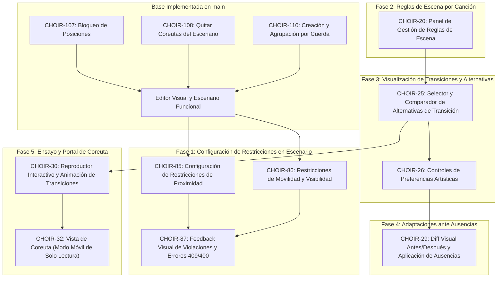

# Roadmap de Ejecución y Dependencias — Frontend (choir-platform-web)

Este documento define el **orden de ejecución recomendado**, las **dependencias técnicas internas de Angular** y las **dependencias con las APIs del backend (`choir-platform`)** para todos los tickets de frontend del proyecto CHOIR.

---

## 1. Estado Actual del Frontend en `main`

Los siguientes tickets de frontend ya han sido implementados, probados con Vitest y mergeados en `main`:

| Ticket | Componente | Descripción | Estado en `main` |
|---|---|---|---|
| **CHOIR-107** | Frontend | Bloqueo y desbloqueo de posiciones en el editor visual | ✅ Completado (PR #12) |
| **CHOIR-108** | Frontend | Eliminación contextual de coreutas desde el escenario | ✅ Completado (PR #14) |
| **CHOIR-110** | Frontend | Creación de formaciones y visualización inicial agrupada por cuerda | ✅ Completado (PR #16) |
| **CHOIR-82** | Frontend | CI y automatización de despliegue en GitHub Pages | ✅ Completado (PR #15) |

---

## 2. Mapa y Grafo de Dependencias (Frontend)

---

## 3. Fases de Ejecución Recomendadas (Frontend)

### Fase 1: Motor de Restricciones en Escenario
*Objetivo: Extender el editor de formaciones (`FormationPage`) para permitir asociar restricciones espaciales y mostrar feedback en caso de conflicto.*

1. **[CHOIR-85](CHOIR-85.md) — Configuración visual de restricciones de proximidad entre coreutas**
   - **Dependencia Backend:** contrato y CRUD de `.../formations/{formationId}/constraints/proximity` (CHOIR-85 Backend) implementados y mergeados en `main`.
   - **Alcance Angular:** Panel lateral o modal en `FormationPage` que permita seleccionar dos coreutas del elenco y fijar una distancia máxima permitida. Representación visual de un conector/enlace entre ambos en el escenario.

2. **[CHOIR-86](CHOIR-86.md) — Configuración visual de restricciones de movilidad y visibilidad**
   - **Dependencia Backend:** `POST/GET/DELETE .../constraints/physical` (CHOIR-86 Backend).
   - **Alcance Angular:** Controles basados exclusivamente en el modelo y las reglas geométricas deterministas confirmados por backend; no inventar fila, altura o prioridad ni inferirlas de datos ausentes.

3. **[CHOIR-87](CHOIR-87.md) — Manejo de errores de validación espacial y feedback en escenario**
   - **Dependencia Backend:** Respuestas estructuradas `409 Conflict` de CHOIR-87 Backend.
   - **Alcance Angular:** Capturar la lista de `violations` devuelta por el servidor al guardar. Resaltar de forma accesible los coreutas infractores en el escenario y mostrar los motivos; conservar los cambios locales para que el director los corrija y guarde explícitamente.

---

### Fase 2: Reglas Especiales de Escena
4. **[CHOIR-20](CHOIR-20.md) — Panel de reglas especiales de escena por canción en el repertorio**
   - **Dependencia Backend:** `GET/POST/PUT/DELETE .../repertoire/{id}/scene-rules` (CHOIR-20 Backend).
   - **Alcance Angular:** Pestaña de "Reglas de Escena" dentro de la vista de Repertorio/Concierto para definir salidas por tandas (ej. 4+4), desplazamientos de solistas y agrupaciones temporales.

---

### Fase 3: Transiciones, Alternativas y Preferencias
5. **[CHOIR-25](CHOIR-25.md) — Comparación y selección de alternativas de transición**
   - **Dependencia Backend:** CHOIR-24 y CHOIR-25 Backend.
   - **Alcance Angular:** Componente para comparar variantes de transición propuestas por el backend: mostrar métricas lado a lado (distancia total, cruces, simultaneidad) y permitir al director previsualizar y elegir una alternativa.

6. **[CHOIR-26](CHOIR-26.md) — Selector y configuración de preferencias artísticas de transición**
   - **Dependencia Backend:** `GET/PUT .../optimization-preferences` (CHOIR-26 Backend).
   - **Alcance Angular:** Controles accesibles para los pesos confirmados. El backend debe resolver primero si existe criterio de simultaneidad y si la preferencia pertenece al concierto o a la formación.

---

### Fase 4: Adaptaciones ante Ausencias
7. **[CHOIR-29](CHOIR-29.md) — Comparador visual y aplicación de adaptaciones por ausencia**
   - **Dependencia Backend:** CHOIR-28 y CHOIR-29 Backend.
   - **Alcance Angular:** Modal de "Gestión de Ausencias": marcar coreutas que no asisten y mostrar un diff visual del escenario (posiciones antes vs propuesta con huecos rellenados). Botón explícito para aplicar la adaptación creando una nueva versión.

---

### Fase 5: Modo Ensayo y Portal del Coreuta
8. **[CHOIR-30](CHOIR-30.md) — Modo ensayo y reproducción interactiva de transiciones**
   - **Dependencia Backend:** `GET .../transitions/{id}/playback-steps` (CHOIR-30 Backend).
   - **Alcance Angular:** Reproductor sobre el escenario con controles de Play, Pausa, Reinicio, Slider de velocidad (1x, 0.5x) y avance paso a paso. Interpolación visual suave respetando `prefers-reduced-motion`.

9. **[CHOIR-32](CHOIR-32.md) — Vista de coreuta con repertorio, posiciones y movimientos individuales**
   - **Dependencias Backend:** Autenticación de coreuta y `GET /api/me/concerts/{id}/my-positions` (CHOIR-32 Backend).
   - **Alcance Angular:** Nueva ruta `/app/mi-ubicacion`: vista mobile-first de solo lectura donde el coreuta ve su tarjeta personal, repertorio del concierto, su coordenada en cada obra y una flecha indicadora del próximo movimiento.

---

## 4. Matriz de Dependencias Cruzadas con `choir-platform` (Backend)

| Ticket Frontend | Requiere del Backend | Ticket Backend Bloqueante | Estado Requerido del Backend |
|---|---|---|---|
| **CHOIR-85** | CRUD de proximidad | **CHOIR-85** | Requiere contrato e implementación mergeados en `main` de `choir-platform` |
| **CHOIR-86** | Restricciones físicas | **CHOIR-86** | Requiere contrato e implementación mergeados en `main` de `choir-platform` |
| **CHOIR-87** | Validación de guardado y violaciones estructuradas | **CHOIR-87** | Requiere contrato e implementación mergeados en `main` de `choir-platform` |
| **CHOIR-20** | Reglas de escena por inclusión de repertorio | **CHOIR-20** | Requiere contrato e implementación mergeados en `main` de `choir-platform` |
| **CHOIR-25** | Alternativas y métricas de transición | **CHOIR-24 / CHOIR-25** | Requiere contratos e implementaciones mergeados en `main` de `choir-platform` |
| **CHOIR-26** | Preferencias de optimización | **CHOIR-26** | Requiere contrato e implementación mergeados en `main` de `choir-platform` |
| **CHOIR-29** | Cálculo y aplicación de ausencias | **CHOIR-28 / CHOIR-29** | Requiere contratos e implementaciones mergeados en `main` de `choir-platform` |
| **CHOIR-30** | Pasos temporales de playback | **CHOIR-30** | Requiere contrato e implementación mergeados en `main` de `choir-platform` |
| **CHOIR-32** | `GET /api/me/concerts/{concertId}/my-positions` y auth de coreuta | **CHOIR-32** | Requiere contrato e implementación mergeados en `main` de `choir-platform` |

Las rutas de esta tabla describen prerequisitos; no afirman que ya estén disponibles. Verificar el estado real de backend y Jira antes de iniciar cada implementación frontend.
